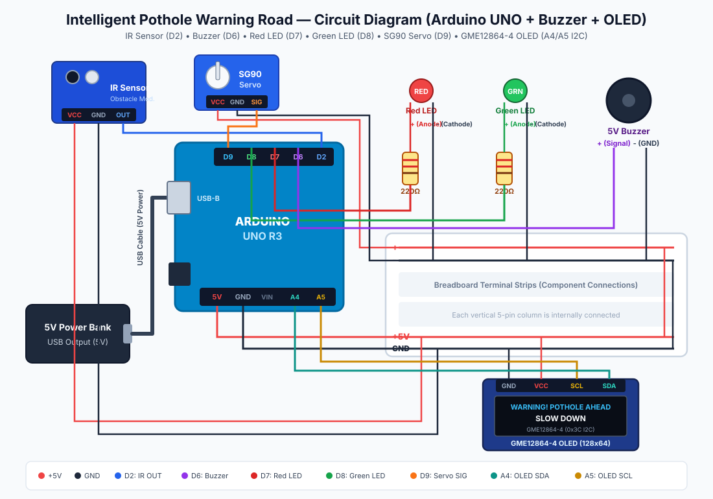

# Intelligent Pothole Warning Road (Arduino Based)

An Arduino-based bidirectional smart road safety model that uses **two IR sensors** (one on each side of the pothole) to detect approaching vehicles from either direction and warn drivers with **visual indicators (Red/Green LEDs)**, an **audible Buzzer alarm**, a **rotating warning sign** (*"POTHOLE AHEAD — SLOW DOWN"*) that turns toward the oncoming car (`+90°` or `-90°` from center), and a **GME12864-4 OLED Display** showing live road status and direction.

---

## How It Works

1. **Normal Road State (Clear):**
   - The **Green LED** stays **ON**.
   - The **Red LED** and **Buzzer** remain **OFF**.
   - The **SG90 Servo Motor** holds the warning sign at its neutral center position (**`90°`**).
   - The **GME12864-4 OLED** displays: **`ROAD STATUS: NORMAL` / `ALL CLEAR` / `Drive Safely`**.
2. **Vehicle Approaches from Side 1 (IR Sensor 1 on `D2`):**
   - The **Servo Motor** turns **`+90°` from center (`180°`)** to face Side 1 traffic.
   - The **Green LED** turns **OFF**, **Red LED** turns **ON**, and the **5V Buzzer** pulses.
   - The **GME12864-4 OLED** displays **`WARNING! / POTHOLE AHEAD! / SLOW DOWN / Car: Side 1 (+90)`**.
3. **Vehicle Approaches from Side 2 (IR Sensor 2 on `D3`):**
   - The **Servo Motor** turns **`-90°` from center (`0°`)** to face Side 2 traffic.
   - The **Green LED** turns **OFF**, **Red LED** turns **ON**, and the **5V Buzzer** pulses.
   - The **GME12864-4 OLED** displays **`WARNING! / POTHOLE AHEAD! / SLOW DOWN / Car: Side 2 (-90)`**.
4. **Auto-Reset:**
   - As soon as the car passes and both sensors stop detecting (`200 ms` debounce via `ALERT_HOLD_MS`), the servo returns to center (**`90°`**), the Red LED and Buzzer turn **OFF**, the Green LED turns **ON**, and the OLED returns to **`ALL CLEAR`**.

> **Servo Angle Note:** An SG90 positional servo accepts angles from **`0°` to `180°`** (negative numbers are not supported by `Servo.write()`). Mounting the sign at the **`90°` midpoint** lets it turn **`+90°` (`180°`)** toward Side 1 and **`-90°` (`0°`)** toward Side 2.

| System State | IR 1 (`D2`) | IR 2 (`D3`) | Green LED (`D8`) | Red LED (`D7`) | Buzzer (`D6`) | Servo Sign (`D9`) | OLED Display (`A4`/`A5`) |
| :--- | :---: | :---: | :---: | :---: | :---: | :---: | :--- |
| **Normal Road** | `HIGH` | `HIGH` | **ON** | OFF | OFF | Center (`90°`) | `ALL CLEAR` / `Drive Safely` |
| **Side 1 Alert** | **`LOW`** | `HIGH` | OFF | **ON** | **Pulsing** | `+90°` (`180°`) | `WARNING! SLOW DOWN` / `Car: Side 1 (+90)` |
| **Side 2 Alert** | `HIGH` | **`LOW`** | OFF | **ON** | **Pulsing** | `-90°` (`0°`) | `WARNING! SLOW DOWN` / `Car: Side 2 (-90)` |

---

## List of Components

| # | Component | Quantity | Purpose |
| :---: | :--- | :---: | :--- |
| 1 | **Arduino UNO R3 / UNO Mini** | 1 | Main microcontroller processing both IR sensors and controlling outputs |
| 2 | **IR Obstacle Avoidance Sensor Modules** | 2 | Detects approaching vehicles on Side 1 (`D2`) and Side 2 (`D3`) |
| 3 | **SG90 Micro Servo Motor** | 1 | Rotates the warning sign `+90°` (`180°`) or `-90°` (`0°`) from center (`90°`) |
| 4 | **5V Active Buzzer** | 1 | Audible alarm when a vehicle approaches the pothole |
| 5 | **GME12864-4 OLED Display (0.96" 128×64, I2C SSD1306)** | 1 | Displays live road status, direction, and pothole warning messages |
| 6 | **Red LED (5mm)** | 1 | Warning light indicator during alert state |
| 7 | **Green LED (5mm)** | 1 | Normal road status indicator |
| 8 | **220Ω Resistors** | 2 | Current-limiting resistors for the Red and Green LEDs |
| 9 | **Breadboard (Half/Full size)** | 1 | Solderless prototyping board for power distribution & LEDs |
| 10 | **Jumper Wires (M-M & M-F)** | 1 set | Connecting Arduino, breadboard, sensors, servo, LEDs, buzzer, and OLED |
| 11 | **5V Power Bank + USB Cable** | 1 | Portable 5V power supply (USB-B for UNO R3, USB-C for UNO Mini) |
| 12 | **Cardboard / Foam Board & Road Craft Materials** | 1 | Physical diorama base with road, pothole, and warning signboard |
| 13 | **Toy Car** | 1 | Demonstration vehicle for triggering either sensor |

---

## Circuit Diagram

See the full color-coded diagram in [`circuit_diagram.svg`](./circuit_diagram.svg):



### ASCII Wiring Schematic

```text
  [5V Power Bank] ===(USB Cable)===> [Arduino UNO USB Port]

                         +-------------------+
                         |    Arduino UNO    |
                         |                   |
   IR Sensor 1 (OUT) --->| D2            5V  |-----> Breadboard (+) 5V Rail
   IR Sensor 2 (OUT) --->| D3            GND |-----> Breadboard (-) GND Rail
   Buzzer (+)      <-----| D6                |
   Red LED (+)     <--[220Ω]-- D7            |
   Green LED (+)   <--[220Ω]-- D8        A4  |<----> GME12864-4 OLED (SDA)
   SG90 Servo SIG  <-----| D9 (PWM)      A5  |-----> GME12864-4 OLED (SCL)
                         +-------------------+

  Breadboard (+) 5V Rail  ---> IR1 VCC, IR2 VCC, SG90 Servo VCC (Red), OLED VCC
  Breadboard (-) GND Rail ---> IR1 GND, IR2 GND, SG90 Servo GND (Brown), OLED GND,
                               Red LED (-), Green LED (-), Buzzer (-)
```

> **Note:** On a standard breadboard, connect the top and bottom `+` / `-` power rails together with two jumper wires if you use both sides, and power the Arduino UNO via its **USB port** from the 5V Power Bank (do **not** supply 5V to `VIN`, as `VIN` requires 7V–12V).

---

## Circuit Connection Table

| Component | Component Pin / Lead | Connect To | Notes |
| :--- | :--- | :--- | :--- |
| **Power Bank (5V)** | USB Output | Arduino UNO **USB Port** | Provides regulated 5V power |
| **Arduino UNO** | `5V` | Breadboard **`+` (5V) Rail** | Supplies 5V to sensors, servo & OLED |
| **Arduino UNO** | `GND` | Breadboard **`-` (GND) Rail** | Common ground reference |
| **IR Sensor 1 (Side 1)** | `VCC` | Breadboard **`+` (5V) Rail** | Sensor 1 power |
| **IR Sensor 1 (Side 1)** | `GND` | Breadboard **`-` (GND) Rail** | Sensor 1 ground |
| **IR Sensor 1 (Side 1)** | `OUT` | Arduino Digital Pin **`D2`** | Triggers `+90°` turn (`180°`) |
| **IR Sensor 2 (Side 2)** | `VCC` | Breadboard **`+` (5V) Rail** | Sensor 2 power |
| **IR Sensor 2 (Side 2)** | `GND` | Breadboard **`-` (GND) Rail** | Sensor 2 ground |
| **IR Sensor 2 (Side 2)** | `OUT` | Arduino Digital Pin **`D3`** | Triggers `-90°` turn (`0°`) |
| **SG90 Servo Motor** | `VCC` (Red wire) | Breadboard **`+` (5V) Rail** | Servo power |
| **SG90 Servo Motor** | `GND` (Brown/Black wire) | Breadboard **`-` (GND) Rail** | Servo ground |
| **SG90 Servo Motor** | `SIG` (Orange/Yellow wire) | Arduino PWM Pin **`D9`** | `90°` center, `180°` (+90), `0°` (-90) |
| **Red LED (Warning)** | Anode (`+`, longer leg) | Arduino Digital Pin **`D7`** via **`220Ω` Resistor** | Turns ON during alert |
| **Red LED (Warning)** | Cathode (`-`, shorter leg) | Breadboard **`-` (GND) Rail** | Ground |
| **Green LED (Normal)** | Anode (`+`, longer leg) | Arduino Digital Pin **`D8`** via **`220Ω` Resistor** | Turns ON when road is clear |
| **Green LED (Normal)** | Cathode (`-`, shorter leg) | Breadboard **`-` (GND) Rail** | Ground |
| **5V Active Buzzer** | Positive (`+`) | Arduino Digital Pin **`D6`** | Sounds pulsing alarm on alert |
| **5V Active Buzzer** | Negative (`-`) | Breadboard **`-` (GND) Rail** | Ground |
| **GME12864-4 OLED** | `GND` | Breadboard **`-` (GND) Rail** | Display ground |
| **GME12864-4 OLED** | `VCC` | Breadboard **`+` (5V) Rail** | Accepts 3.3V–5V |
| **GME12864-4 OLED** | `SCL` | Arduino Analog Pin **`A5`** (`SCL`) | I2C clock line |
| **GME12864-4 OLED** | `SDA` | Arduino Analog Pin **`A4`** (`SDA`) | I2C data line |

---

## Running the Project

1. Open [`pothole.ino`](./pothole.ino) in the **Arduino IDE**.
2. Install the required OLED libraries via **Sketch → Include Library → Manage Libraries...**:
   - **Adafruit SSD1306** (by Adafruit)
   - **Adafruit GFX Library** (by Adafruit)
3. Go to **Tools → Board** and select **Arduino UNO** (or **Arduino UNO Mini**).
4. Go to **Tools → Port** and select your connected Arduino COM/USB port.
5. Click **Upload** (`Ctrl+U`).
6. Disconnect from PC (optional) and plug the USB cable into the **5V Power Bank**.

### Calibration & Tips
- **Servo Center Alignment:** Power up the Arduino with no car near either sensor so the servo moves to **`90°` (`SIGN_CENTER_ANGLE`)**, then attach the sign stick to the servo horn in its neutral resting orientation. That ensures Side 1 rotates `+90°` (`180°`) and Side 2 rotates `-90°` (`0°`). If your servo rotates opposite to your road layout, swap `SIGN_SIDE1_ANGLE` and `SIGN_SIDE2_ANGLE` (or swap pins `2` and `3`) in `pothole.ino`.
- **OLED I2C Address:** Most GME12864-4 displays use address `0x3C` (`OLED_I2C_ADDR` in `pothole.ino`). If your display remains blank, check your `A4`/`A5` wiring and try changing `OLED_I2C_ADDR` to `0x3D`.
- **IR Sensor Sensitivity:** Turn the blue potentiometer screw on each IR sensor module with a small screwdriver until it reliably triggers only when the toy car approaches that side of the pothole.
- **Sensor Polarity:** Standard IR obstacle modules output `LOW` when detecting an object (`SENSOR_DETECTED = LOW` in `pothole.ino`). If yours outputs `HIGH`, change `SENSOR_DETECTED` to `HIGH`.
- **Passive Buzzer Option:** If you use a *passive* buzzer instead of an *active* 5V buzzer, replace `digitalWrite(BUZZER_PIN, HIGH/LOW)` with `tone(BUZZER_PIN, 2000)` and `noTone(BUZZER_PIN)`.
